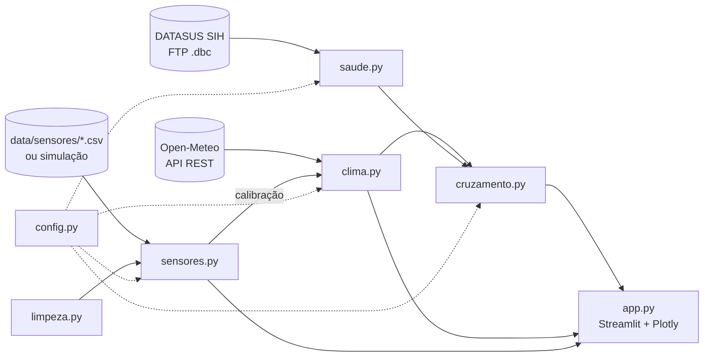

# Documentação técnica

Para quem vai **manter, corrigir ou ampliar** o projeto. Para usar o painel, veja o
[guia "Como usar"](COMO_USAR.md).

---

## Sumário

1. [Arquitetura](#1-arquitetura)
2. [Estrutura de pastas](#2-estrutura-de-pastas)
3. [Fluxo de dados](#3-fluxo-de-dados)
4. [Módulos e funções](#4-módulos-e-funções)
5. [Formato das tabelas](#5-formato-das-tabelas)
6. [Métodos](#6-métodos)
7. [Configuração (`meteo/config.py`)](#7-configuração-meteoconfigpy)
8. [Cache e desempenho](#8-cache-e-desempenho)
9. [Como estender](#9-como-estender)
10. [Testes](#10-testes)
11. [Docker](#11-docker)
12. [Limitações técnicas conhecidas](#12-limitações-técnicas-conhecidas)

---

## 1. Arquitetura

O projeto tem duas camadas:

- **`meteo/`**: um pacote Python **sem nenhuma dependência do Streamlit**. Baixa, limpa e
  analisa os dados, e devolve DataFrames e dicionários. Pode ser usado em notebooks e scripts.
- **`app.py`**: a interface Streamlit. Só lê os filtros, chama o `meteo/` e desenha os
  gráficos (Plotly). Não contém regra de análise.



---

## 2. Estrutura de pastas

```
app.py                     interface (Streamlit)
meteo/
  __init__.py              descrição do pacote
  config.py                todos os parâmetros e critérios
  clima.py                 Open-Meteo: download, tratamento, critérios de calor, tendências
  saude.py                 DATASUS/SIH: download, tratamento, recortes e grupos de CID
  cruzamento.py            clima × internações: normal esperado, comparações, conclusões
  limpeza.py               limpeza de séries de sensores (temperatura e umidade)
  sensores.py              sensores: leitura, simulação, índice de calor, calibração
tests/test_tratamentos.py  testes automáticos (pytest)
docs/                      este documento e o guia de uso
data/cache/                downloads (fora do Git)
data/sensores/             CSVs dos sensores (fora do Git)
Dockerfile, .dockerignore  ambiente reprodutível
requirements.txt           dependências
CHANGELOG.md               histórico de mudanças
```

---

## 3. Fluxo de dados

Sequência executada a cada interação no painel (`app.py`):

1. **Clima:** `clima.carregar()` → `baixar()` (cache diário) → `tratar()` → `marcar_calor()`.
   Resultado: `cl_om`, uma linha por dia desde 1991.
2. **Limiares:** `clima.limiares(cl_om)` → percentil 90 dos verões de 1991–2020. Esta régua é
   **sempre** a da Open-Meteo, mesmo quando a série corrigida é usada.
3. **Sensores:** `sensores.obter(cl_om)` → dados reais de `data/sensores/` ou simulação →
   `limpeza.limpar()` → índice de calor → `diario()` → `calibrar()`.
4. **Fonte do clima:** se o usuário escolhe "Heliópolis corrigida", o app calcula
   `cl = clima.marcar_calor(sensores.corrigir(cl_om, calib), lim=limiares)`. Senão, `cl = cl_om`.
5. **Internações:** `saude.anos_completos(meses_disponiveis())` → para cada ano escolhido,
   `baixar_mes()` (15 arquivos por ano, com cache) → `tratar()` → `internacoes_diarias()`.
6. **Cruzamento:** `cruzamento.analisar(cl, internacoes, grupo, criterio, ...)` →
   `montar_tabela()` (normal esperado) → `por_faixa()`, `correlacao()`, `defasagem()`,
   `comparar_recortes()` → `gerar_conclusoes()`.
7. **Arboviroses:** `cruzamento.arboviroses_mensal(cl, internacoes, recorte)`.
8. **Gráficos:** o `app.py` desenha os resultados.

---

## 4. Módulos e funções

### `meteo/clima.py`
| Função | Entrada → saída |
|---|---|
| `baixar()` | → DataFrame diário bruto da Open-Meteo. Cache em `data/cache/clima_<data>.parquet`; se a API falhar, usa o último arquivo salvo. |
| `tratar(df)` | Tipos, duplicatas, valores impossíveis, grade diária completa, `ano`/`mes`, e chama `marcar_calor`. |
| `carregar()` | `tratar(baixar())`. |
| `limiares(df)` | → `{"sensacao_max": float, "tmin": float}`: o percentil 90 do período de referência nos meses quentes. |
| `marcar_calor(df, lim=None)` | Adiciona as colunas booleanas `dia_quente`, `noite_quente` e `onda_calor`. `lim` fixa os limiares. |
| `resumo_anual(df)` | → dias de cada critério por ano e `completo` (ano com ≥ 360 dias). |
| `tendencia(anual, criterio)` | → reta de mínimos quadrados (só anos completos) e `por_decada`. |
| `por_decada(anual, criterio)` | → média de dias de calor por ano em cada década. |
| `mapa_ano_mes(df, criterio)` | → matriz ano × mês com a contagem de dias. |

### `meteo/saude.py`
| Função / objeto | Descrição |
|---|---|
| `GRUPOS` | Dicionário `código → nome` dos grupos de internação. `GRUPOS_DIARIOS` exclui `arboviroses`. |
| `RECORTES` | `config.RECORTES` (`heliopolis`, `regiao`, `cidade`). |
| `meses_disponiveis()` | Lista `AAMM` dos arquivos `RDSPaamm.dbc` no FTP. Sem acesso, usa os do cache. |
| `anos_completos(meses)` | Anos com os 12 meses + 3 de atraso publicados. |
| `baixar_mes(aamm)` | Baixa o `.dbc`, converte (`pyreaddbc`), filtra (`_ler_dbf`) e salva `internacoes_AAMM.parquet`. Apaga os arquivos grandes. |
| `_ler_dbf(caminho)` | Lê o DBF em modo `raw`, com filtro nos bytes: município de residência em `config.MUNICIPIOS`, urgência (`CAR_INT=02`) e AIH principal (`IDENT=1`). |
| `tratar(df)` | Datas, idade em anos, recortes por CEP e grupos de CID (uma coluna booleana por recorte e por grupo). |
| `internacoes_diarias(df, anos)` | → uma linha por dia; colunas `<recorte>__<grupo>` com contagens. |
| `carregar(anos)` | Tudo acima para os anos pedidos. |

### `meteo/cruzamento.py`
| Função | Descrição |
|---|---|
| `montar_tabela(clima, internacoes, criterio, descontar_feriados)` | Junta clima e internações. Calcula, para cada coluna `<recorte>__<grupo>`, as colunas `__normal`, `__var` e `__ref`. |
| `_marcas_de_calor(clima, criterio)` | `dia_calor`, `depois_0…depois_7` e `janela_calor`, calculados na **série contínua** do clima. |
| `feriados(datas)` | Feriados nacionais e de SP, Carnaval, Sexta-feira Santa, Corpus Christi e 24/12–01/01. |
| `comparar(bloco, c)` | Observado × normal em um conjunto de dias, com IC 95% → `variacao`, `ic_inf`, `ic_sup`, `significativo`. |
| `por_faixa(tab, grupo, var)` | Comparação por faixa de temperatura, só nos meses quentes. |
| `correlacao(tab, grupo, var)` | Spearman: temperatura × % acima do normal (meses quentes). |
| `defasagem(tab, grupo)` | Comparação nos dias `k` = 0…7 depois de um dia de calor. |
| `comparar_recortes(tab, grupo, pop)` | Variação em cada recorte nos dias de calor, taxa por 100 mil e razão de razões (Heliópolis e região contra a cidade). |
| `arboviroses_mensal(clima, internacoes, recorte)` | Série mensal e Spearman com temperatura média e chuva de 0–2 meses antes. |
| `gerar_conclusoes(...)` | Textos do quadro "O que os dados mostram". |
| `analisar(clima, internacoes, grupo, criterio, pop, feriados, limiares)` | Orquestra tudo → dicionário com `tabela`, `faixas`, `correlacao`, `defasagem`, `comparacao`, `conclusoes`, `limiar` etc. |

### `meteo/limpeza.py`
`limpar(df)` → `(df_limpo, relatorio)`. Aplica, nesta ordem: `padronizar_timestamp`,
`padronizar_unidades` (°F → °C), `remover_outliers` (−5 a 50 °C; 0 a 100%),
`tratar_ausentes` (interpola até 3 leituras seguidas, dentro de cada sensor) e remoção de
duplicatas `(sensor_id, timestamp)`. O `relatorio` conta linhas, ausentes, outliers e
sensores em °F.

### `meteo/sensores.py`
| Função | Descrição |
|---|---|
| `obter(clima)` | **Ponto de entrada.** → `(df, relatorio, eh_simulado)` ou `None`. Prioridade: CSVs reais → simulação (se `SENSORES_PLACEHOLDER`) → `None`. |
| `carregar()` | Lê `data/sensores/*.csv` (separador detectado; aceita vírgula decimal). |
| `simular(clima)` | **Placeholder.** Leituras horárias fictícias do último verão, com erros inseridos de propósito. |
| `indice_calor(t, ur)` | Índice de calor da NOAA (Rothfusz + ajustes), em °C. |
| `diario(df)` | Máxima, mínima, umidade média, índice de calor máximo e faixa de risco, por sensor e dia. |
| `horas_em_risco(df)` | Horas por dia em cada faixa de risco. Detecta sozinho o intervalo entre leituras. |
| `perfil_horario(df)` | Temperatura média por hora do dia. |
| `calibrar(dia, clima)` | Diferença média sensor − Open-Meteo (máxima e mínima), só com sensores de Heliópolis e dias com ≥ 18 leituras. Exige ≥ 14 dias. |
| `corrigir(clima, calib)` | Soma as diferenças à série. A sensação térmica recebe o delta da máxima. |

---

## 5. Formato das tabelas

**Clima (`clima.carregar()`)**: uma linha por dia.

| coluna | descrição |
|---|---|
| `data` | data (`datetime64`) |
| `tmax`, `tmin`, `tmedia` | temperatura máxima, mínima e média (°C) |
| `sensacao_max` | sensação térmica máxima (°C, Open-Meteo `apparent_temperature_max`) |
| `chuva` | precipitação (mm) |
| `ano`, `mes` | calendário |
| `dia_quente`, `noite_quente`, `onda_calor` | critérios de calor (bool) |

**Internações diárias (`saude.carregar()`)**: uma linha por dia, com `data` e uma coluna
`<recorte>__<grupo>` (inteiro) para cada combinação. Exemplo: `regiao__idosos`.

**Tabela de análise (`analisar()["tabela"]`)**: as colunas acima, mais:

| coluna | descrição |
|---|---|
| `dia_calor`, `janela_calor` | dia de calor; dia de calor ou até `DIAS_DEPOIS` dias depois |
| `depois_0` … `depois_7` | o dia veio `k` dias depois de um dia de calor |
| `verao`, `feriado` | mês quente; feriado ou fim de ano |
| `<r>__<g>__normal` | internações esperadas no dia |
| `<r>__<g>__var` | % acima do normal |
| `<r>__<g>__ref` | casos usados para estimar o normal do mês (incerteza) |

**Sensores (`sensores.obter()`)**: `sensor_id`, `timestamp`, `temperatura` (°C), `umidade` (%),
`unidade_temp` (sempre `C` após a limpeza) e `indice_calor`.

---

## 6. Métodos

**Dia de calor.** O limiar é o percentil 90 (`PERCENTIL_DIA_CALOR`) da variável nos meses
quentes (`MESES_QUENTES`) de 1991–2020 (`CLIMATOLOGIA`). Onda de calor = sequência de
`DIAS_ONDA` ou mais dias quentes.

**Normal esperado.** Para cada dia *d*, recorte e grupo:

```
normal(d) = média(internações nos dias comuns do mesmo mês e ano) × peso(dia da semana de d)
dias comuns = fora da janela de calor e fora de feriados
peso(dds)   = média no dia da semana / média geral   (dias sem feriado)
```

Se um mês não tem dias comuns, usa a média de todos os dias não feriados do mês.

**Comparação e intervalo de 95%.** Para um conjunto de dias, com O observados e N esperados:

```
razão = O / N            variação = 100 × (razão − 1)
var(log razão) = 1/O  +  Σ_mês (N_mês² / C_mês) / N²
IC 95% = razão × exp(±1,96 × √var)
```

O primeiro termo é a variação de Poisson dos casos. O segundo é a incerteza do próprio
normal, estimado com C casos em cada mês. Dias do mesmo mês compartilham o mesmo erro. É
**significativo** quando o IC não inclui 1 (0%).

**Diferença entre lugares.** Razão de razões `(O_a/N_a)/(O_b/N_b)`, com variâncias somadas.
Trata os recortes como independentes; a sobreposição (Heliópolis ≈ 0,5% e região ≈ 5% da
cidade) é pequena.

**Correlação.** Spearman, nos meses quentes, entre a variável de clima e `__var`.

**Arboviroses.** Soma mensal das internações × média mensal de `tmedia` e soma de `chuva`,
deslocadas 0, 1 e 2 meses; Spearman.

**Índice de calor (NOAA).** Fórmula de Rothfusz em °F, com os ajustes para umidade abaixo de
13% e acima de 85%, e a fórmula simples quando o resultado fica abaixo de 80 °F. Faixas de
risco: 27 / 32 / 41 / 54 °C.

**Calibração.** Para os dias com sensores de Heliópolis: `Δmax = média(tmax_sensores −
tmax_OM)` e `Δmin` da mesma forma. A série corrigida soma Δ a todos os dias desde 1991.

---

## 7. Configuração (`meteo/config.py`)

| Parâmetro | Padrão | Para que serve |
|---|---|---|
| `LATITUDE`, `LONGITUDE` | −23,6105; −46,5925 | ponto da Open-Meteo |
| `MUNICIPIOS` | `["355030"]` | municípios de residência lidos do SIH (**apague o cache de internações ao mudar**) |
| `CEPS_HELIOPOLIS` | 04229, 04230, … | prefixos de 5 dígitos de Heliópolis |
| `CEPS_REGIAO` | `["042"]` | prefixos da região do Ipiranga |
| `RECORTES` | heliopolis, regiao, cidade | recortes analisados |
| `SENSORES_PLACEHOLDER` | `True` | usa dados simulados quando não há CSVs |
| `PREFIXO_SENSOR_HELIOPOLIS` | `"heliopolis"` | identifica sensores dentro de Heliópolis |
| `PLACEHOLDER_EXCESSO` | 3 sensores | excesso de calor dos sensores **simulados** |
| `CLIMATOLOGIA` | (1991, 2020) | período de referência dos limiares |
| `PERCENTIL_DIA_CALOR` | 90 | percentil do limiar |
| `MESES_QUENTES` | nov–mar | meses do verão |
| `DIAS_ONDA` | 3 | duração mínima da onda de calor |
| `CRITERIOS` | 3 critérios | nome, variável e texto de cada critério |
| `POP_SP`, `POP_HELIOPOLIS` | Censo 2022 | taxa por 100 mil |
| `DIAS_DEPOIS` | 2 | duração da janela de calor |
| `MAX_DEFASAGEM` | 7 | dias no gráfico de defasagem |
| `ANOS_PANDEMIA` | 2020, 2021 | anos fora da seleção padrão |

---

## 8. Cache e desempenho

| O quê | Onde | Validade |
|---|---|---|
| Clima | `data/cache/clima_<data>.parquet` | um arquivo por dia; o antigo é apagado |
| Internações | `data/cache/internacoes_AAMM.parquet` | permanente (só as linhas filtradas, poucos MB) |
| Em memória (Streamlit) | `st.cache_data` | clima 12 h, lista do FTP 24 h, internações e sensores até mudar a entrada |

O download de cada arquivo mensal do SIH leva ~1 min, e um ano tem 15 arquivos. A leitura do
DBF filtra nos bytes (`raw=True`) para não decodificar ~100 colunas por linha.

---

## 9. Como estender

**Novo grupo de internação (CID):**
1. Em `saude.GRUPOS`, acrescente `"codigo": "Nome para o usuário"`.
2. Em `saude.tratar()`, crie `df["codigo"] = cid.str.match(r"^…")`.
3. Pronto: ele aparece no seletor e em todos os gráficos. Acrescente um caso em
   `tests/test_tratamentos.py`.

**Novo recorte territorial** (ex.: São Caetano do Sul):
1. `config.MUNICIPIOS.append("354880")` e **apague** `data/cache/internacoes_*.parquet`.
2. Em `config.RECORTES`, acrescente `"sao_caetano": "São Caetano do Sul"`.
3. Em `saude.tratar()`, crie `df["sao_caetano"] = munic == "354880"`.
4. Em `app.py`, dê uma cor ao recorte em `COR`. Em `cruzamento.comparar_recortes`, informe a
   população, se quiser a taxa por 100 mil.

**Novo critério de calor:**
1. Em `config.CRITERIOS`, acrescente a entrada (`nome`, `plural`, `var`, `texto`).
2. Em `clima.marcar_calor()`, crie a coluna booleana com o mesmo código.
3. Se `var` for uma variável nova, acrescente as faixas em `cruzamento.FAIXAS` e o texto em
   `cruzamento.TEXTO_VAR`.

**Nova variável da Open-Meteo:** acrescente-a em `clima.VARIAVEIS` (nome na API → nome no
projeto) e apague `data/cache/clima_*.parquet`.

**Novo gráfico:** escreva o cálculo como função em `meteo/` (sem Streamlit) e desenhe no
`app.py` com `mostrar(fig)`. Use as cores de `COR` para os lugares. Indique a incerteza com
barras cheias/vazadas (`estilo_barras`).

**Trocar os sensores simulados pelos reais:** veja o quadro no topo de `meteo/sensores.py` ou
a seção 8 do [guia de uso](COMO_USAR.md#8-colocar-os-dados-dos-sensores).

---

## 10. Testes

```bash
python -m pip install pytest
python -m pytest
```

| Teste | O que garante |
|---|---|
| `test_limpeza_converte_fahrenheit_remove_outliers_e_interpola` | as etapas de `limpeza.limpar` |
| `test_indice_de_calor_bate_com_a_tabela_da_noaa` | 30 °C e 70% → 35 °C |
| `test_onda_de_calor_exige_dias_seguidos` | detecção de sequências |
| `test_feriados_incluem_carnaval_e_fim_de_ano` | calendário de feriados |
| `test_recortes_e_grupos_das_internacoes` | CEP → recortes e CID → grupos |
| `test_placeholder_dos_sensores_e_calibracao` | simulação, limpeza, calibração e correção |
| `test_grupo_arboviroses` | CID A90–A92 |

Os testes não acessam a internet.

---

## 11. Docker

```bash
docker build -t calor-heliopolis .
docker run -p 8501:8501 -v "$(pwd)/data:/app/data" calor-heliopolis
```

A imagem usa `python:3.12-slim` e instala `build-essential`, caso o `pyreaddbc` precise ser
compilado. O volume em `/app/data` preserva o cache e os sensores.

---

## 12. Limitações técnicas conhecidas

- **O FTP do DATASUS** é instável e bloqueado em algumas redes. O app avisa e mantém as abas de
  clima e sensores funcionando.
- **Prefixos de CEP** são uma aproximação dos limites de Heliópolis e da região.
- **A calibração** é um deslocamento constante, medido em um período e aplicado a toda a
  série. Com vários meses de dados, pode-se trocar por uma regressão por mês ou por estação.
- **A correção da sensação térmica** usa o delta da temperatura máxima. Com dados reais,
  pode-se calibrar a sensação térmica diretamente pelo índice de calor dos sensores.
- **O teste de diferença entre lugares** ignora a pequena sobreposição entre os recortes.
- **O app foi validado com dados simulados** no ambiente de desenvolvimento, porque esse
  ambiente não acessava as fontes reais.
